# Hi, I'm Benson 👋

### Computer Science Engineering Student | AI/ML Enthusiast

I'm a third-year CSE student at **College of Engineering Kidangoor**, interested in building practical software and exploring AI-powered solutions.

- 🤖 Exploring Artificial Intelligence, Machine Learning, and LLMs.
- 💻 Building projects with Python and experimenting with backend development.
- 🔬 Interested in understanding how technology works, from AI systems to embedded hardware.
- 🚀 Learning by building, experimenting, and solving real-world problems.

### 🛠️ Technologies & Tools

  
  
  
  
  
  
  
  

### 🚀 Featured Projects

#### 1. [SummarAI](https://github.com/bens-max/SummarAI)

An AI-powered PDF summarization application that extracts document content, processes text in chunks, and generates structured summaries.

**Technologies:** Python · Flask · Gemini API

#### 2. [PhishLens](https://github.com/bens-max/PhishLens)

An AI-assisted phishing detection project designed to analyze suspicious URLs and messages and help users identify potential threats.

**Technologies:** Python · FastAPI · AI/ML

#### 3. [RGB Light Mixer](https://github.com/bens-max/RGB-Light-Mixer)

An embedded systems project using an STM32 microcontroller to control RGB LED colours through PWM, with an LCD interface for displaying colour names.

**Technologies:** C · STM32 · GPIO · PWM · LCD

### 📊 GitHub Statistics

  
  

### 📈 Contribution Activity

  

---

  

